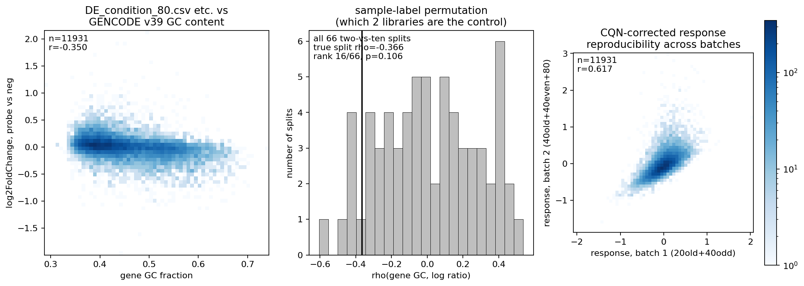
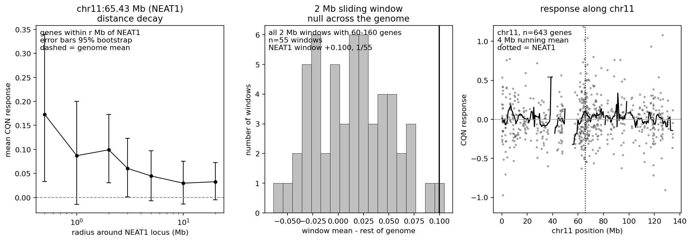
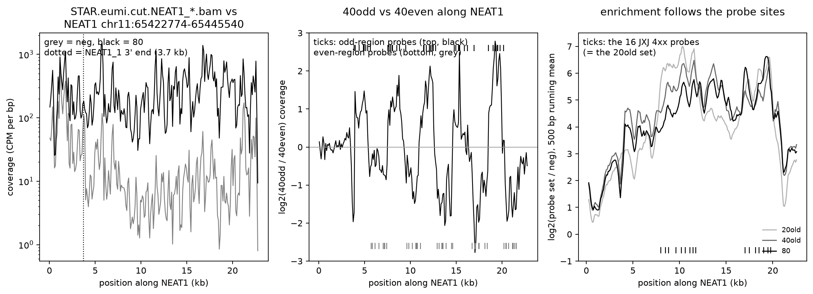
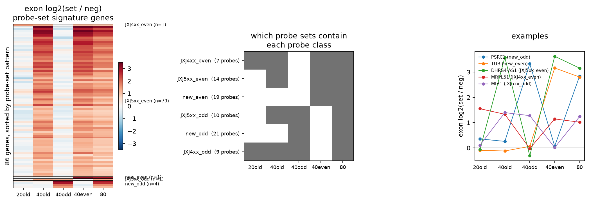
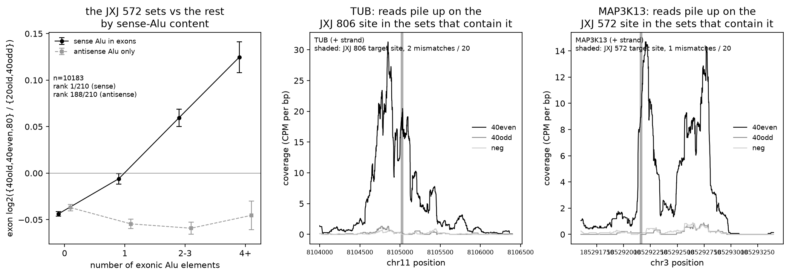
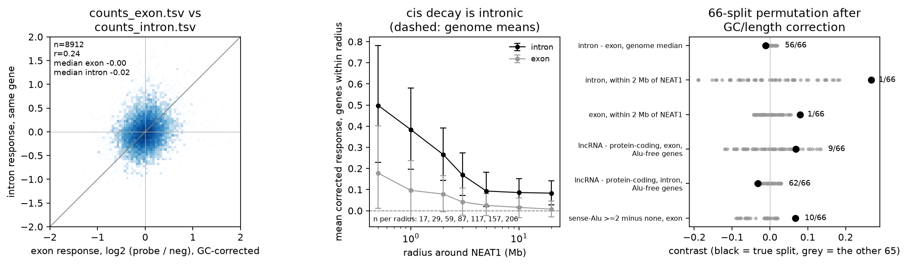

# Paraspeckle transcriptome — what determines NEAT1 enrichment?

Analysis for the Regev lab (NYU) paraspeckle project. Hybridisation-capture
pulldown against NEAT1, sequenced against a no-probe control, asking what about a
gene sets its `log2FoldChange`.

Data is from the Fei lab and is **not** in this repo — see [Data](#data).

## Result in one paragraph

**First pass** (DE tables only): GC content looks like the determinant
($\rho = -0.38$) but is not separable from library-level technical variation
(66-split label permutation, rank 16/66, $p = 0.106$); after CQN three effects
cleared the permutation (lncRNA class, antisense/divergent, within 2 Mb of NEAT1).

**Second pass** (the 12 BAMs and the probe table), which overturns most of the
first-pass interpretation:

- **The capture works on RNA fragments at the probe sites.** NEAT1_1 is not
  co-captured; `40odd`/`40even` enrichment alternates with probe-region parity along
  NEAT1 (2-3 fold); fragment length fits 200-400 nt. This is ChIRP/RAP-like
  hybridisation capture, not a proximity label, so a non-NEAT1 fragment comes down
  only by annealing to an oligo or by being crosslinked to a NEAT1 fragment.
- **The "batch" was never a batch: probe JXJ 572 sits in an AluSz6 inside NEAT1.**
  Its 20-nt target is 3 mismatches from the Alu consensus. The `{40old, 40even, 80}`
  vs `{20old, 40odd}` split is sets-with-572 vs sets-without. 78 of the 79 batch-2
  signature genes carry a sense exonic Alu (vs 43% background); reads pile up on the
  exact target sites (MAP3K13, SIRT7, DHRS4-AS1 on the 572 site, TUB on JXJ 806,
  PSRC1 on JXJ 818, MCU on JXJ 815); genome-wide, enrichment in the 572 sets is a
  dose curve in mismatches at the best exonic site (0 mm +0.77, 1 mm +0.22, 2 mm
  +0.03, none -0.04 log2). The batch structure disappears in Alu-free genes.
  TMEM9B-AS1 and EMSY-DT, two first-pass "top genes", are 572 captures.
- **No mature RNA other than NEAT1 is enriched 2-fold in all five probe sets.**
- **After region-level GC correction the genome-wide intron excess vanishes**
  (rank 56/66). What survives is **cis and intronic**: corrected intron response
  for genes within 2 Mb of NEAT1 is +0.27 log2 (rank 1/66; in Alu-free genes,
  in protein-coding genes, in every set and every library), decaying over
  ~1-2 Mb, with the mature mRNAs of the same genes barely moving (+0.08). The
  NEAT1 2 Mb window and its three chr11 neighbours are the top four windows in the
  genome. This is nascent transcripts of NEAT1's neighbours coming down with NEAT1,
  which matches Yap, Chung & Makeyev 2022 (HyPro-seq, same HeLa: chr11q clusters,
  intron retention) at the neighbourhood level though not gene by gene.
- The lncRNA exon effect shrinks to +0.07 ($p = 0.14$) once Alu genes are removed
  and GC is corrected; carried as a lead only.

**Revised hypothesis:** nothing in this dataset is enriched because it is in a
paraspeckle. The pulldown captures NEAT1_2 fragments at the 80 probe sites;
everything else is (i) mature RNA annealing directly to one oligo, dominated by
sense-Alu transcripts on JXJ 572, or (ii) a small, GC-robust intronic enrichment
of genes transcribed within ~1-2 Mb of the NEAT1 locus. No sequence-encoded
targeting of mature mRNAs; GC, length and abundance are technical.

Full write-up with figures: [`notes/`](notes/).

## Data

Not redistributed. The scripts expect, relative to the repo root:

```
data/NEAT1_input.xlsx        # gene counts, 67,928 x 12 (whole-gene-span, stranded)
data/ColData_NEAT1.xlsx      # sample sheet
data/DE_condition_{20old,40old,40odd,40even,80}.csv
data/ngs4/*.sort.rmDup.bam   # 12 deduplicated STAR BAMs (second pass)
data/ngs4/NEAT1 probe positions_2026_08_batch.xlsx   # the 80 probes
```

Six conditions × 2 replicates: `neg` (no-probe control), `20old`, `40old`,
`40odd`, `40even`, `80`. The 80 probes tile NEAT1_2 (3.8-21.6 kb) in 10 regions
of 8; `40odd`/`40even` are the odd/even-numbered regions, `20old` = JXJ 401-420,
`40old` = `20old` + JXJ 535-576, and JXJ 783-822 are the new design present only in
`40odd`/`40even`/`80`. Cells are HeLa (HPV18 E6/E7 reads).

Reference files are downloaded by the scripts: GENCODE **v39**
`chr_patch_hapl_scaff` and **GRCh38.p13**. That release is the only one whose
67,928 Geneids match the DE tables 1:1 and in order (v38 has 67,049, v40 has
67,939, v42+ reorders chr1).

## Run order

```bash
pip install -r requirements.txt
```

**Features and model**

| script | what it does |
|---|---|
| `analysis/gene_features.py` | parses the GENCODE GTF into per-region intervals |
| `analysis/gene_features_genome.py` | GC + length per gene from GRCh38.p13 (memmap pass) |
| `analysis/deseq_run.py` | pydeseq2, per-condition and pooled probe-vs-neg, apeglm shrinkage |
| `analysis/build_master.py` | joins features, LFCs and counts into `master.pkl` |

**First pass, and why it fails**

| script | what it does |
|---|---|
| `analysis/feature_vs_lfc.py` | feature scan on the raw LFC |
| `analysis/h_nascent.py` | intron content / nascent-RNA hypothesis |
| `analysis/h_gcbias.py` | per-library GC profiles, null contrasts |
| `analysis/h_gcbias2.py` | **the 66-split label permutation** |

**Correction**

| script | what it does |
|---|---|
| `analysis/cqn.py` | per-library GC/length spline removal; builds the response |
| `analysis/scan_cqn.py` | feature scan on the corrected response |
| `analysis/probe_sets.py` | structure across the five probe sets |
| `analysis/inspect_counts.py` | raw counts for set-specific vs consistent genes |
| `analysis/batch_structure.py` | library PCA — finds the processing batch |
| `analysis/offtarget.py` | probe-membership logic + NEAT1 16-mer test |

**Hypotheses tested**

| script | what it does |
|---|---|
| `analysis/repeats.py` | RepeatMasker Alu counts by orientation, IRAlu pairs |
| `analysis/neat1_kmers.py` | 25-mers shared with NEAT1, sense vs antisense |
| `analysis/motifs.py` | all 4,096 6-mers in 3′UTRs and transcripts |
| `analysis/eclip_fetch.py` / `eclip_test.py` | ENCODE eCLIP for paraspeckle proteins + controls |
| `analysis/spatial.py` | spatial autocorrelation along chromosomes |
| `analysis/cis.py` | distance to the NEAT1 locus |
| `analysis/cis_control.py` | genome-wide 2 Mb sliding-window null |
| `analysis/cis_gcmatch.py` | GC-matched control (chr11q13 is GC 0.557 vs 0.436) |
| `analysis/abund_perm.py` | permutation on abundance, lncRNA, cis |

**Second pass (BAMs and probes)**

| script | what it does |
|---|---|
| `analysis/probe_scan.py` | parses the probe sheet, maps the 80 target sites onto NEAT1 (`work/probes80.tsv`) |
| `analysis/probe_scan_genome.py` | genome-wide scan for all 80 target sites at ≤3 mismatches, per-gene best sense/antisense hit |
| `analysis/nascent_cqn.py` | exon vs intron counts with region-level GC/length correction, 66-split permutation, cis decay, window null, HyPro concordance |
| `analysis/fig7_nascent.py` | Fig 7 |
| `analysis/run_genome_chain.sh` | unzip genome → features → probe scan → master → CQN |

Exon/intron/junction counting (featureCounts `-s 1` on SAFs built from GENCODE v39),
NEAT1 coverage profiles, the membership-vector fits, the Alu counts and the Hi-C proxy
were run inline; their outputs live in `work/` (not committed, see the notes).

**Integration and output**

| script | what it does |
|---|---|
| `analysis/final_model.py` | decomposition + leave-one-chromosome-out CV |
| `analysis/whoare.py` | characterises the replicating gene set |
| `analysis/robustness.py` | re-derives the headline results under other normalisations |
| `figs.py` | the three figures |
| `style.py` | Oded's house plotting style (`hist2d_compare`) |
| `notes/notes.js` | builds the notes document |

## Figures

| | |
|---|---|
|  | **Fig 1.** GC looks like the answer and then does not survive label permutation. |
|  | **Fig 2.** The response decays with genomic distance from the NEAT1 locus. |
|  | **Fig 3.** Only three effects clear the sample-label permutation. |
|  | **Fig 4.** The pulldown captures NEAT1_2 fragments at the probe sites. |
|  | **Fig 5.** 86 genes whose five-set profile matches one probe-membership vector. |
|  | **Fig 6.** The batch-2 signature is cross-hybridisation of sense Alus to probe JXJ 572. |
|  | **Fig 7.** After GC correction the only nascent signal is cis to the NEAT1 locus. |

## Open

1. Drop JXJ 572 (and JXJ 403/406) from the probe set; screen any future design
   against RepeatMasker. Analyse `20old`/`40odd` as the clean sets meanwhile.
2. Scrambled / non-targeting probe set with the same handle. Beads-only does not
   control for annealing, which is the largest term.
3. NEAT1 knockdown or NONO/SFPQ knockdown: the cis intronic signal should survive
   if it is nascent-transcript proximity to the NEAT1 gene, and vanish if it needs
   the paraspeckle body.
4. 4C or HeLa Hi-C from the NEAT1 promoter; the GM12878 proxy adds nothing beyond
   linear distance.
5. More `neg` replicates (4-6) and a nuclear-extract input lane.
