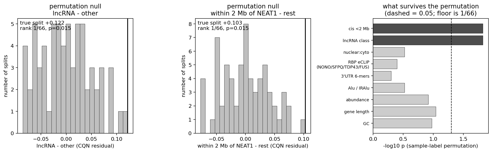

# Paraspeckle transcriptome — what determines NEAT1 enrichment?

Analysis for the Regev lab (NYU) paraspeckle project. Hybridisation-capture
pulldown against NEAT1, sequenced against a no-probe control, asking what about a
gene sets its `log2FoldChange`.

Data is from the Fei lab and is **not** in this repo — see [Data](#data).

## Result in one paragraph

GC content looks like the determinant ($\rho = -0.38$, replicates across probe
halves, survives partialling on expression). It is **not separable from
library-level technical variation**: with 2 control libraries against 10 pulldowns,
a permutation over all $\binom{12}{2} = 66$ choices of "which libraries are the
control" puts the true split at rank 16/66, $p = 0.106$. Gene length and abundance
go the same way.

After CQN correction the response gets *more* reproducible ($r = 0.70$ across
independent library sets, reliability $0.76$). Three effects then clear the same
permutation at the $1/66$ floor ($p = 0.015$):

| effect | size | rank |
|---|---|---|
| lncRNA vs rest | +0.122 | 1/66 |
| antisense/divergent vs rest | +0.137 | 1/66 |
| within 2 Mb of NEAT1 vs rest | +0.103 | 1/66 |

Everything else fails: 3′UTR inverted Alus, all 4,096 6-mers, sequence similarity
to NEAT1, eCLIP binding by NONO/SFPQ/FUS/TDP-43/HNRNPK/MATR3, nuclear retention,
and every compartment-scale explanation (spatial autocorrelation of the response
between neighbouring genes never exceeds $r = +0.011$ at any separation from
0.1–50 Mb).

**Working hypothesis:** enrichment is set by where the transcript is made and how
long it stays on chromatin, not by anything in the mature RNA. Paraspeckles
nucleate on nascent NEAT1 at its own locus; with a short labelling radius what gets
captured is NEAT1, nascent transcripts of chr11 neighbours, and chromatin-tethered
lncRNA/divergent transcripts.

Caveat: reliability is 0.76 but the three features give leave-one-chromosome-out
CV $R^2 = 0.022$, so 97% of the reproducible signal is gene-specific and
unexplained. The `neg` control is no-probe, which controls for beads but not for
hybridisation capture — a scrambled probe set is the biggest open gap.

Full write-up with figures: [`notes/`](notes/).

## Data

Not redistributed. The scripts expect, relative to the repo root:

```
data/NEAT1_input.xlsx        # gene counts, 67,928 x 12
data/ColData_NEAT1.xlsx      # sample sheet
data/DE_condition_{20old,40old,40odd,40even,80}.csv
```

Six conditions × 2 replicates: `neg` (no-probe control), `20old`, `40old`,
`40odd`, `40even`, `80`. `40even` and `40odd` are disjoint halves of the 80-oligo
set; `20old`/`40old` are an earlier probe design.

Reference files are downloaded by the scripts: GENCODE **v39**
`chr_patch_hapl_scaff` and **GRCh38.p13**. That release is the only one whose
67,928 Geneids match the DE tables 1:1 and in order (v38 has 67,049, v40 has
67,939, v42+ reorders chr1).

## Run order

```bash
pip install -r requirements.txt
```

**Features and model**

| script | what it does |
|---|---|
| `analysis/gene_features.py` | parses the GENCODE GTF into per-region intervals |
| `analysis/gene_features_genome.py` | GC + length per gene from GRCh38.p13 (memmap pass) |
| `analysis/deseq_run.py` | pydeseq2, per-condition and pooled probe-vs-neg, apeglm shrinkage |
| `analysis/build_master.py` | joins features, LFCs and counts into `master.pkl` |

**First pass, and why it fails**

| script | what it does |
|---|---|
| `analysis/feature_vs_lfc.py` | feature scan on the raw LFC |
| `analysis/h_nascent.py` | intron content / nascent-RNA hypothesis |
| `analysis/h_gcbias.py` | per-library GC profiles, null contrasts |
| `analysis/h_gcbias2.py` | **the 66-split label permutation** |

**Correction**

| script | what it does |
|---|---|
| `analysis/cqn.py` | per-library GC/length spline removal; builds the response |
| `analysis/scan_cqn.py` | feature scan on the corrected response |
| `analysis/probe_sets.py` | structure across the five probe sets |
| `analysis/inspect_counts.py` | raw counts for set-specific vs consistent genes |
| `analysis/batch_structure.py` | library PCA — finds the processing batch |
| `analysis/offtarget.py` | probe-membership logic + NEAT1 16-mer test |

**Hypotheses tested**

| script | what it does |
|---|---|
| `analysis/repeats.py` | RepeatMasker Alu counts by orientation, IRAlu pairs |
| `analysis/neat1_kmers.py` | 25-mers shared with NEAT1, sense vs antisense |
| `analysis/motifs.py` | all 4,096 6-mers in 3′UTRs and transcripts |
| `analysis/eclip_fetch.py` / `eclip_test.py` | ENCODE eCLIP for paraspeckle proteins + controls |
| `analysis/spatial.py` | spatial autocorrelation along chromosomes |
| `analysis/cis.py` | distance to the NEAT1 locus |
| `analysis/cis_control.py` | genome-wide 2 Mb sliding-window null |
| `analysis/cis_gcmatch.py` | GC-matched control (chr11q13 is GC 0.557 vs 0.436) |
| `analysis/abund_perm.py` | permutation on abundance, lncRNA, cis |

**Integration and output**

| script | what it does |
|---|---|
| `analysis/final_model.py` | decomposition + leave-one-chromosome-out CV |
| `analysis/whoare.py` | characterises the replicating gene set |
| `analysis/robustness.py` | re-derives the headline results under other normalisations |
| `figs.py` | the three figures |
| `style.py` | Oded's house plotting style (`hist2d_compare`) |
| `notes/notes.js` | builds the notes document |

## Figures

| | |
|---|---|
|  | **Fig 1.** GC looks like the answer and then does not survive label permutation. |
|  | **Fig 2.** The response decays with genomic distance from the NEAT1 locus. |
|  | **Fig 3.** Only three effects clear the sample-label permutation. |

## Open

1. Scrambled / non-targeting probe control. Largest single gap.
2. More `neg` replicates — $n = 2$ is why the GC question is unanswerable.
3. Intron vs exon counts (the Wu et al. Group A/B split). Best direct test of the
   hypothesis above. Needs featureCounts on an intron SAF, or split BAMs.
4. Probe coordinates on NEAT1_2 — do `40even`/`40odd` tile core vs shell?
5. Hi-C contact frequency with chr11:65.43 Mb in place of linear distance.
6. Reporter: swap the 3′UTR between a top gene and a flat control at one fixed
   locus. If localisation is positional, the swap should do nothing.
